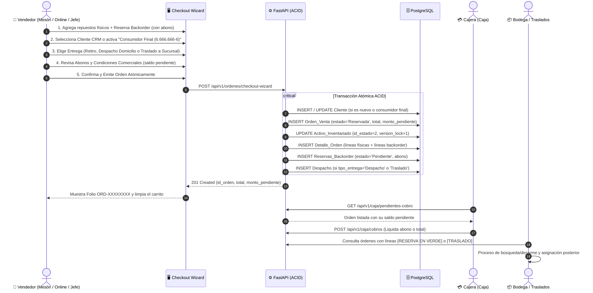

# Arquitectura y Guía Operativa: Checkout Wizard y Reservas por Encargo (Backorder)

> **Documento Técnico de Referencia (SPEC-HU-05)**  
> **Sistema**: Plataforma Cresal Capstone  
> **Módulos Afectados**: Mesón de Ventas, Checkout, Reservas Backorder, Módulo de Caja, Bodega y Despachos.

---

## 1. Resumen de Cambios Realizados

Se implementó una reingeniería completa del flujo de compra en el **Mesón de Ventas**, transformándolo en una experiencia guiada **Wizard de 5 Pasos Secuenciales**, con soporte nativo para **Reservas por Encargo ("Compras en Verde" / Backorders)** y persistencia transaccional **ACID**.

### 1.1 Archivos Modificados y Creados

```
├── backend/
│   ├── schemas.py                                    # [MODIFY] DTOs Pydantic V2: ReservaBackorderDTO, DespachoDTO, CheckoutWizardRequest/Response
│   ├── routers/ordenes.py                            # [MODIFY] Endpoint transaccional ACID con Upsert de Cliente y Traslados: POST /api/v1/ordenes/checkout-wizard
│   └── tests/test_checkout_wizard.py                 # [NEW] 6 Pruebas automatizadas Pytest (ACID, Rollback, RBAC, Despacho)
│
├── frontend/
│   ├── lib/features/auth/services/auth_service.dart  # [MODIFY] Aislamiento de Carrito por Usuario (vacía el carrito al hacer clearToken/logout)
│   ├── lib/features/ventas/
│   │   ├── models/cart_item_model.dart               # [MODIFY] Soporte de ReservaBackorderCartItem en carrito reactivo global
│   │   ├── models/checkout_wizard_models.dart        # [MODIFY] DTOs Dart: ClienteWizardModel (con toClienteInputJson), DespachoModel, etc.
│   │   ├── controllers/cart_controller.dart          # [MODIFY] agregarReservaBackorder(...) sincronizado bidireccionalmente
│   │   ├── controllers/checkout_wizard_controller.dart# [MODIFY] Manejo de traslado, asignación de vendedor y abonos parciales
│   │   ├── services/ventas_service.dart              # [MODIFY] Método HTTP processCheckoutWizard()
│   │   ├── presentation/
│   │   │   ├── widgets/modal_backorder_form.dart     # [NEW] Diálogo modal para parametrizar piezas en verde
│   │   │   ├── screens/catalogo_screen.dart          # [MODIFY] Botón rápido AppBar y estado vacío para Backorder
│   │   │   ├── screens/ventas_main_screen.dart       # [MODIFY] Reemplazo total de CarritoScreen por CheckoutWizardScreen
│   │   │   └── screens/checkout_wizard_screen.dart   # [MODIFY] Formulario CRM unificado con Consumidor Final, Traslados y Abonos
│   └── test/features/ventas/checkout_wizard_test.dart# [NEW] 9 Pruebas unitarias y de widgets en Flutter
│
└── specs/SPEC-HU-05.md                               # [MODIFY] Checklist 100% completada y validada
```

---

## 2. ¿Cómo Funciona el Flujo de Reservas por Encargo (Backorder / Compras en Verde)?

Una **Reserva por Encargo (Backorder)** ocurre cuando un cliente solicita una pieza automotriz específica (ej: *Caja de cambios para Toyota Corolla 2021*) que **no se encuentra físicamente en el stock inmediato** de la desarmaduría, pero la empresa se compromete a conseguirla o desarmarla bajo un precio y abono acordados.



### 2.1 Los 5 Pasos del Wizard en el Mesón de Ventas

| Paso | Nombre | Descripción y Reglas de Negocio |
| :--- | :--- | :--- |
| **Paso 1** | **Ítems & Reservas** | El vendedor carga repuestos desde inventario, agrega ítems manuales o abre el `ModalBackorderForm` para crear piezas por encargo. No permite avanzar con carrito vacío. |
| **Paso 2** | **Cliente CRM** | Formulario unificado con campo RUT integrado. Incluye switch de **Consumidor Final (Sin RUT)** que autocompleta el cliente `6.666.666-6`. Si es un cliente existente o nuevo, se gestiona todo en la misma tarjeta. |
| **Paso 3** | **Logística & Despacho** | Selector de 3 modalidades: **Retiro en Tienda** (mesón), **Despacho a Domicilio** (formulario de dirección y transportista) o **Traslado a otra Sucursal** (Viña del Mar / Limache). Si es Vendedor Online, permite asignar el responsable en sucursal. |
| **Paso 4** | **Condiciones & Abonos** | Desglose financiero en tiempo real. Permite ingresar **Monto de Abono / Anticipo (\$):** personalizado (calculando en vivo el saldo pendiente para Caja) e instrucciones para Bodega. |
| **Paso 5** | **Revisión Final & Emisión** | Resumen consolidado. Al presionar **Confirmar**, se ejecuta la llamada transaccional atómica al backend, se genera la orden y se limpia el carrito. |

---

## 3. Ejemplos Prácticos y Payloads

### Ejemplo 1: Venta Híbrida Completa (Físico + Backorder + Despacho)

Un cliente compra un motor que está en stock (\$650.000), encarga una caja de cambios que no está en stock (\$450.000 con \$150.000 de abono inicial) y solicita despacho a domicilio.

#### Payload enviado a `POST /api/v1/ordenes/checkout-wizard`:
```json
{
  "id_cliente": "dce79d5c-e1ad-4d28-b848-f95872e66982",
  "tipo_entrega": "Despacho Domicilio",
  "total_venta": 1100000,
  "monto_pendiente": 950000,
  "items_inventariados": [
    "a5c89895-46b0-4f51-86ea-19f8cf49dc74"
  ],
  "items_manuales": [],
  "reservas": [
    {
      "id_categoria_requerida": 2,
      "marca_requerida": "Toyota",
      "modelo_requerido": "Corolla",
      "anio_requerido": 2021,
      "cilindrada_requerida": "1.8L",
      "combustible_requerido": "Bencina",
      "transmision_requerida": "CVT",
      "notas_preparacion": "Revisar sincronizadores y sensor de reversa",
      "precio_acordado": 450000,
      "monto_abonado": 150000
    }
  ],
  "datos_despacho": {
    "direccion_envio": "Av. Libertad 555, Depto 302",
    "receptor_nombres": "Andrea Montesinos",
    "receptor_rut": "19.999.888-7",
    "receptor_telefono": "+56987654321",
    "id_comuna_destino": 1,
    "empresa_transporte": "Chilexpress"
  }
}
```

#### Respuesta transaccional del Backend (201 Created):
```json
{
  "id_orden": "8f3b1452-9b21-4f10-9118-243e887a11ca",
  "estado": "Reservada",
  "estado_orden": "Reservada",
  "total_venta": 1100000,
  "monto_pendiente": 950000,
  "reservas_generadas": 1,
  "activos_reservados": 1,
  "despacho_generado": true,
  "msg": "Orden generada exitosamente.",
  "mensaje": "Orden generada exitosamente."
}
```

---

### Ejemplo 2: Venta Pura de Compra en Verde (Solo Reserva Backorder)

Un cliente encarga un motor importado de \$500.000 y abona \$200.000 en el acto.

#### Payload JSON:
```json
{
  "id_cliente": "dce79d5c-e1ad-4d28-b848-f95872e66982",
  "tipo_entrega": "Retiro",
  "total_venta": 500000,
  "monto_pendiente": 300000,
  "items_inventariados": [],
  "items_manuales": [],
  "reservas": [
    {
      "id_categoria_requerida": 1,
      "marca_requerida": "Nissan",
      "modelo_requerido": "Qashqai",
      "anio_requerido": 2019,
      "cilindrada_requerida": "2.0L",
      "precio_acordado": 500000,
      "monto_abonado": 200000,
      "notas_preparacion": "Adquisición de desarme nacional"
    }
  ]
}
```

---

## 4. Comunicación e Interacción entre Módulos

```
 ┌─────────────────────────────────────────────────────────────┐
 │                MÓDULO MESÓN DE VENTAS                       │
 │  • CheckoutWizardScreen (5 pasos con navegación y retorno)  │
 │  • ModalBackorderForm (Configuración técnica)               │
 │  • CheckoutWizardController (Estado reactivo persistente)   │
 └──────────────────────────────┬──────────────────────────────┘
                                │ POST /checkout-wizard
                                ▼
 ┌─────────────────────────────────────────────────────────────┐
 │               CAPA TRANSACCIONAL BACKEND                    │
 │  • Control de Acceso RBAC (Roles 2, 4, 5, 6, 7)             │
 │  • Bloque Atómico try/commit/rollback                       │
 └───────┬──────────────────────┬──────────────────────┬───────┘
         │                      │                      │
         ▼                      ▼                      ▼
 ┌───────────────┐      ┌───────────────┐      ┌───────────────┐
 │   MÓDULO DE   │      │   MÓDULO DE   │      │   MÓDULO DE   │
 │     CAJA      │      │    BODEGA     │      │   DESPACHOS   │
 ├───────────────┤      ├───────────────┤      ├───────────────┤
 │ • Lee órdenes │      │ • Activos     │      │ • Registra    │
 │   'Reservadas'│      │   físicos en  │      │   orden de    │
 │ • Permite     │      │   estado '2'  │      │   envío       │
 │   liquidar    │      │ • Backorders  │      │ • Receptor y  │
 │   abonos o    │      │   marcados    │      │   dirección   │
 │   totales     │      │   para compra │      │   asociados   │
 └───────────────┘      └───────────────┘      └───────────────┘
```

1. **Ventas -> Backend**: Emisión segura vía JWT Bearer. Valida stock y concurrencia optimista (`version_lock`).
2. **Backend -> Caja**: La orden se guarda con `estado_orden = 'Reservada'` y `monto_pendiente = total - abono`. La cajera puede consultar la bandeja de cobros pendientes y procesar el pago en efectivo, tarjeta o transferencia.
3. **Backend -> Bodega**: Los repuestos físicos pasan a `id_estado = 2` (Reservado) para que ningún otro vendedor los venda. Las reservas por encargo generan un registro en la tabla `Reservas_Backorder` para gestión de compras.
4. **Backend -> Despachos**: Si la orden tiene `tipo_entrega == 'Despacho Domicilio'`, se crea el registro en la tabla `Despacho` con `estado_despacho = 'Por Enviar'`.

---

## 5. Control de Seguridad, RBAC y Casos de Borde

1. **RBAC Estricto**:
   - Vendedores (`id_rol == 2, 7`), Jefe de Ventas (`id_rol == 6`), Administradores (`id_rol == 4, 5`) tienen permiso para emitir órdenes.
   - Bodegueros (`id_rol == 1`) y Cajeras (`id_rol == 3`) reciben **`403 Forbidden`** al intentar emitir órdenes de venta.
2. **Rollback Automático**:
   - Si un repuesto físico fue vendido por otro vendedor una milésima de segundo antes, el backend aborta la transacción completa y revierte las inserciones de reservas y despachos.
3. **Persistencia en Navegación (Frontend)**:
   - Retroceder al Paso 1 o 2 en la pantalla no reinicia el formulario ni borra las reservas agregadas, garantizando una UX fluida para el vendedor en el mesón.
4. **Protección de Ciclo de Vida**:
   - Todas las llamadas asíncronas de búsqueda de clientes y emisión de orden implementan `if (!mounted) return;` para prevenir fugas de memoria o errores de contexto.

---

## 6. Resultados de Validación Automatizada

- **Backend**: **131 / 131 tests pasando en verde (100%)** (`pytest -v`).
- **Backend Lint**: **0 errores de estilo** (`flake8`).
- **Frontend**: **234 / 234 tests pasando en verde (100%)** (`flutter test`).
- **Frontend Analyze**: **0 errores / 0 warnings** en todos los componentes creados (`flutter analyze`).
