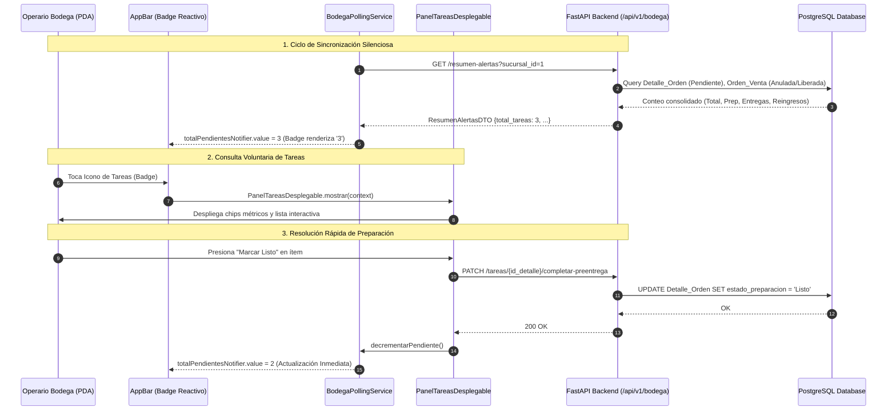

# Arquitectura & Guía Técnica — SPEC-HU-06: Optimización UI Bodega PDA & Badge Reactivo

Este documento detalla la implementación técnica, arquitectura de componentes, flujo de eventos y resolución de tareas de bodega de acuerdo con la especificación **SPEC-HU-06**.

---

## 1. Contexto y Objetivos Principales

- **Zero Visual Disruption (Cero Intrusión UI)**: Los operarios de bodega que utilizan terminales móviles PDA realizan tareas críticas de escaneo óptico y movimiento de pallets. Las notificaciones Push/Snackbars simuladas anteriores interrumpían el flujo de trabajo y robaban el foco visual.
- **Badge Numérico Reactivo**: Se consolida el estado de la carga de trabajo en un `Badge` en el `AppBar` del terminal bodega (`HomeScreen`), visible solo cuando hay tareas pendientes (`isLabelVisible: totalPendientes > 0`).
- **Panel Desplegable de Tareas (`PanelTareasDesplegable`)**: Modal tipo bottom sheet que desglosa la carga operativa por categorías (Preparaciones, Salidas/Barrera, Reingresos) y permite ejecutar resoluciones inmediatas ("Marcar Listo", "Escaneo Barrera").
- **Decrecimiento Inmediato (Zero Latency UI)**: Al completar una pre-entrega, el contador reactivo decrementa instantáneamente en la interfaz de usuario antes de sincronizar el nuevo ciclo de polling.

---

## 2. Diagrama de Flujo y Comunicación entre Módulos



---

## 3. Endpoints del Backend (`backend/routers/bodega.py`)

### 1. `GET /api/v1/bodega/resumen-alertas`
- **Seguridad**: Requiere JWT Token (Rol: Bodeguero, Cajero, Supervisor o Administrador).
- **Parámetros**: `sucursal_id` (opcional, fallback a la sucursal del token).
- **Respuesta JSON**:
```json
{
  "total_tareas": 4,
  "desglose_preparacion": 2,
  "desglose_entregas": 1,
  "desglose_reingresos": 1
}
```

### 2. `GET /api/v1/bodega/tareas-pendientes`
- Retorna la lista detallada y priorizada de tareas operativas (Preparaciones urgentes primero, seguidas de Salidas liberadas, Reingresos e Impresión QR).

### 3. `PATCH /api/v1/bodega/tareas/{id_detalle}/completar-preentrega`
- Marca la preparación de pre-entrega de un repuesto de orden como `'Listo'` y actualiza `fecha_actualizacion`.

---

## 4. Componentes Frontend (Flutter)

| Componente / Archivo | Responsabilidad |
| :--- | :--- |
| [`bodega_polling_service.dart`](file:///d:/CresalRepoCapstone/frontend/lib/features/alertas/services/bodega_polling_service.dart) | Gestor singleton de ciclo de polling reactivo. Gestiona `totalPendientesNotifier`, `resumenNotifier`, `tareasNotifier` y `decrementarPendiente()`. |
| [`panel_tareas_desplegable.dart`](file:///d:/CresalRepoCapstone/frontend/lib/features/alertas/presentation/widgets/panel_tareas_desplegable.dart) | Modal Bottom Sheet con resumen visual de métricas, filtros por tipo de tarea, acción rápida "Marcar Listo" y acceso directo al tablero completo. |
| [`home_screen.dart`](file:///d:/CresalRepoCapstone/frontend/lib/features/home/presentation/screens/home_screen.dart) | AppBar con `Badge(isLabelVisible: count > 0)` conectado a `totalPendientesNotifier`. Eliminación de Toasts / Snackbars invasivos. |
| [`logistica_service.dart`](file:///d:/CresalRepoCapstone/frontend/lib/features/alertas/services/logistica_service.dart) | Cliente HTTP con métodos `obtenerResumenAlertas()` y `completarPreentrega()`. |

---

## 5. Pruebas Automatizadas

- **Backend (Pytest)**:
  - `backend/tests/test_bodega_alertas.py`: 3 tests cubriendo resumen vacío, resumen con múltiples tareas y decremento tras PATCH `completar-preentrega`.
  - Suite completa: **134 / 134 tests pasando en verde**.
- **Frontend (Flutter Test)**:
  - `frontend/test/features/alertas/bodega_polling_test.dart`: 7 tests cubriendo ciclo de polling, notifiers reactivos, decremento sin latencia, renderizado/ocultamiento del Badge y `PanelTareasDesplegable`.
  - Suite completa: **242 / 242 tests pasando en verde**.
