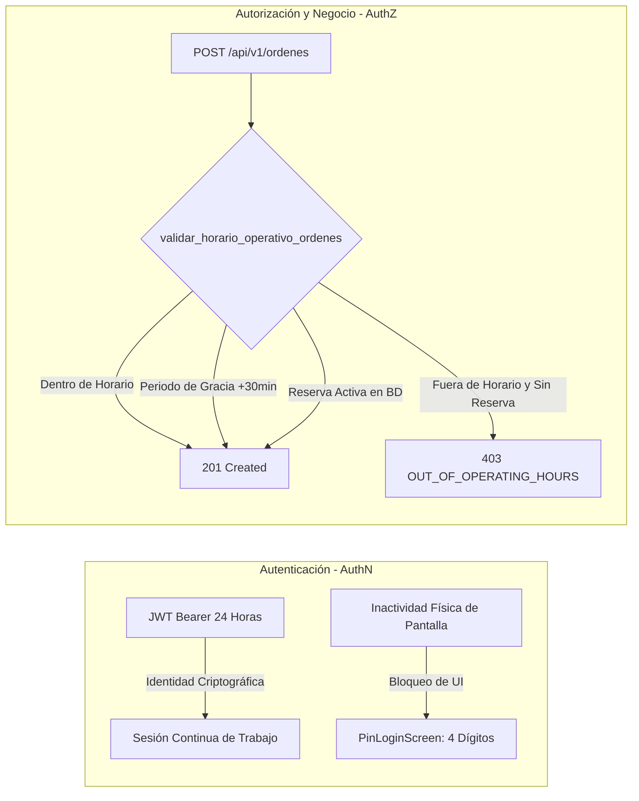
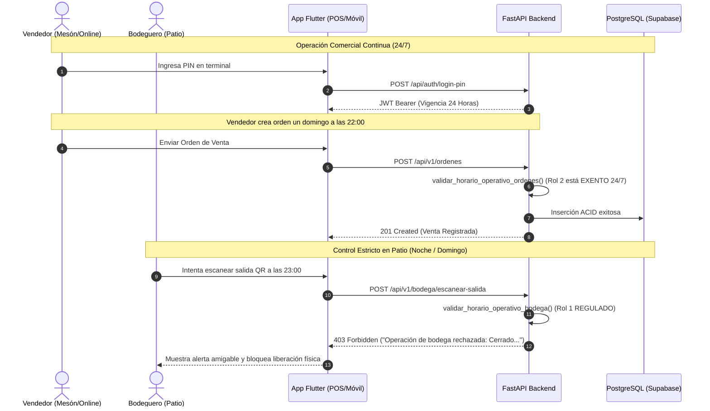

# Arquitectura de Sesión JWT, Control de Turnos y Periodo de Gracia

**Proyecto:** Cresal-SaaS (Frontend Flutter + Backend FastAPI)  
**Estándar:** Desacoplamiento AuthN (Identidad) vs. AuthZ (Políticas de Negocio Operativas)  
**Audiencia:** Desarrolladores, Arquitectos de Software, Auditores y Gerencia  

---

## 1. Contexto y Problema Inicial

Durante la operación continua de la plataforma en mostrador de ventas y bodegas, se detectó un fallo crítico de continuidad operativa:
- **Expiración intempestiva:** Los usuarios sufrían constantes desconexiones y errores `401 Unauthorized` mientras interactuaban activamente con la app.
- **Destrucción de trabajo en curso:** Al gatillarse el error 401, el cliente Flutter invocaba un vaciado total del carrito en el backend, liberando los repuestos reservados y expulsando bruscamente al vendedor a la pantalla de login.
- **Incertidumbre de turnos:** Existía la duda de si el token JWT debía expirar con la jornada laboral (Lunes a Viernes 18:30, Sábados 14:00) y qué ocurría cuando un vendedor estaba en medio de la venta de un repuesto de alto valor (ej. un motor) justo a la hora de salida, o cuando vendedores móviles consultaban repuestos fuera de horario.

---

## 2. Revisión y Comparativa de Documentación Existente (.md)

Antes de definir la solución técnica, se auditó la totalidad de los archivos de especificación del repositorio:

| Documento Auditado | Contenido / Directriz Relevante | Diagnóstico y Brecha Detectada |
| :--- | :--- | :--- |
| `AUDIT-SPRINTS-1-TO-3.md` | Hallazgo ALTO-04: Recomendaba `TOKEN_EXPIRE_MINUTES: int = 480` (8 horas de jornada laboral). | En el código de `backend/core/config.py` se encontraba fijado por defecto en **30 minutos**, provocando la muerte de la sesión a la media hora exacta de uso. |
| `DICCIONARIO_ERRORES.md` | Error `SESSION_EXPIRED` (401): *"Tu sesión ha expirado. Ingresa tu PIN nuevamente. Redirigir automáticamente a `/pin-login` limpiando credenciales."* | La implementación en Flutter malinterpretó "limpiar credenciales" llamando a `logout()`, lo que ejecutaba `CartController.liberarYVaciarEnBackend()`, eliminando el carrito del cliente. |
| `USUARIOS_ROLES.md` | Establece el modelo de **Enrolamiento de Terminal** (Email/Password) y **Reingreso Rápido por PIN** (4 dígitos en pantalla táctil/numpad). | Los dispositivos físicos tienen roles dispares: la PDA de bodega no sale del galpón, mientras que los vendedores y gerencia operan en celulares y laptops dentro y fuera del horario de oficina. |
| `specs/SPEC-HU-TAREA-1.md` | Especifica que el vencimiento de sesión por inactividad debe regresar a `PinLoginScreen` **sin borrar el enrolamiento**. | No existía un detector de inactividad de pantalla; el JWT moría por reloj absoluto sin importar si el usuario estaba tipeando o navegando. |
| `specs/SPEC-HU-TAREA-3.md` | Define la reserva temporal atómica de **15 minutos** en base de datos (`Activo_Inventariado.reserva_expira_en`). | Esta reserva existía para evitar colisiones entre vendedores, pero no estaba conectada con el control de cierre de tienda. |

---

## 3. Diagnóstico de los 3 Errores de Código

1. **`TOKEN_EXPIRE_MINUTES = 30` en `backend/core/config.py`:**  
   Al arrancar la aplicación sin cargar el `.env` local de la subcarpeta, Pydantic caía en el valor predeterminado de 30 minutos.
2. **Carga relativa de `.env`:**  
   `ConfigDict(env_file=".env")` buscaba el archivo en el directorio de ejecución actual (`cwd`). Al iniciar desde la raíz del repositorio, ignoraba `backend/.env`.
3. **Flujo 401 autodestructivo en Frontend:**  
   En `frontend/lib/features/auth/services/auth_service.dart`, el método `manejarSesionExpirada()` ejecutaba `await logout()`, invocando la liberación de reservas en backend y vaciando el carrito del vendedor en curso.

---

## 4. Desacoplamiento Arquitectónico: AuthN (Identidad) vs. AuthZ (Políticas de Negocio)

La industria de software empresarial (ERPs de distribución, POS de retail y recicladores vehiculares como LKQ y Copart) prohíbe explícitamente acoplar la expiración del JWT a la hora de salida de los trabajadores:

### ¿Por qué 24 horas y por qué NO da "Pase Libre"?
* **¿Qué otorga el token de 24 horas?**  
  Otorga únicamente **identidad de red**: el backend sabe quién es el usuario. Permite que el operario trabaje su jornada completa (incluyendo horas extra o inventarios de cierre de mes) sin ser expulsado sorpresivamente. Si suelta el dispositivo, la pantalla se bloquea por PIN, pero el estado de la aplicación no se destruye.
* **¿Da pase libre para vender de noche o en domingos?**  
  **NO.** Las operaciones críticas (crear órdenes, modificar inventario, cobrar en caja) están blindadas por la política de autorización de negocio (`core/policies.py`). Si un vendedor de mesón envía un pedido a las 22:00 horas, el endpoint responde con un `HTTP 403 Forbidden` informando que la sucursal se encuentra cerrada.

---

## 5. Evaluación de Soluciones y Decisión de Diseño

Se evaluaron dos alternativas para implementar el control de turnos:

| Criterio | Opción Descartada: Tabla Dinámica en BD (`horarios_sucursal`) | Opción Seleccionada: Políticas en Código (`core/policies.py`) |
| :--- | :--- | :--- |
| **Impacto en BD** | Requiere migración DDL (`CREATE TABLE`), claves foráneas y modelo ORM. | **0 cambios en PostgreSQL** (cero riesgo de migración). |
| **Sobrecarga (Overhead)** | Consulta a base de datos en cada intento de checkout. | Instantáneo en memoria utilizando `ZoneInfo("America/Santiago")`. |
| **Mantenimiento** | Requiere desarrollar un módulo administrativo CRUD completo para gestionar aperturas y cierres. | Centralizado en configuración limpia y testeada. |
| **Idoneidad para Cresal** | Sobre-ingeniería para una red de sucursales con horarios comerciales estables. | **Ideal**: Sencilla, robusta, altamente testeable y lista para producción. |

---

## 6. Resolución del Caso Crítico: Venta al Filo de la Salida

### El problema:
Un cliente entra a las 18:25 a comprar un motor de $1.800.000. A las 18:30 suena el timbre de salida. El vendedor está cargando los datos del cliente en el checkout. ¿Se debe bloquear la venta? **Jamás.**

### La solución: Doble Barrera con Periodo de Gracia (Grace Period)
1. **Margen de Gracia Temporal (30 minutos post-cierre):**
   - Lunes a Viernes: Apertura 08:30, Cierre 18:30. Gracia extendida hasta las **19:00**.
   - Sábados: Apertura 09:00, Cierre 14:00. Gracia extendida hasta las **14:30**.
   - Domingos: Cerrado para venta presencial.
2. **Respeto a Reservas Atómicas Preexistentes:**
   - Si son las 19:15 y el vendedor continúa en el checkout, el backend inspecciona los ítems en `Activo_Inventariado`.
   - Si el motor posee una reserva atómica activa (`reserva_expira_en > now_utc`) asignada a ese vendedor antes del corte, **el sistema reconoce la transacción como en curso y permite consolidar la orden**.
   - Si un vendedor intenta iniciar una venta nueva desde cero a las 19:15, el sistema la rechaza inmediatamente.

---

## 7. Matriz de Roles y Reglas de Negocio

| ID Rol | Rol | Restricción Horaria | Justificación Operativa |
| :---: | :--- | :---: | :--- |
| **1** | **Bodeguero** | **Sujeto a Turno Estricto** | **Operaciones de patio reguladas**: Bloqueo estricto de salidas por barrera digital (`/bodega/escanear-salida`) y recepción física fuera de turno. |
| **2** | **Vendedor Mesón** | **Exento (24/7)** | **Venta y cotización continua**: Puede consultar repuestos, armar cotizaciones y crear ventas en cualquier momento (ej. fines de semana o noche para clientes de alto valor). |
| **3** | **Caja** | **Sujeto a Turno + Gracia** | **Movimientos de dinero regulados**: Bloqueo de cobros (`/caja/cobros/registrar`) fuera de jornada. Posee 30 min de gracia para cuadre diario y clientes en mostrador. |
| **4** | **Gerente** | **Exento (24/7)** | Requiere supervisar KPIs, facturación y auditorías en cualquier momento (ej. domingo en la noche desde su hogar). |
| **5** | **Administrador** | **Exento (24/7)** | Mantenimiento técnico de infraestructura, diagnósticos, registros y configuración de sistema. |
| **6** | **Jefe de Ventas** | **Exento (24/7)** | Tasación de precios en `/bandeja_precios`, aprobaciones de crédito y supervisión comercial 24/7. |
| **7** | **Vendedor Online** | **Exento (24/7)** | Canal omnicanal y remoto; cotizaciones y coordinación de despachos para regiones a deshora. |

---

### 7.1. Tratamiento del Horario de Chile y Estacionalidad (Verano vs. Invierno)

Un aspecto técnico vital en la arquitectura de `backend/core/policies.py` es la gestión del huso horario oficial de Chile continental:
* **Resolución vía IANA:** El sistema utiliza `ZoneInfo("America/Santiago")` nativo de Python (`zoneinfo`).
* **Cambio de hora automático:** Chile alterna entre el Horario de Invierno (**UTC-4**) y el Horario de Verano (**UTC-3**). Al apoyarse en la base de datos de husos horarios IANA, **el backend calcula automáticamente la hora oficial local sin requerir cálculos manuales de offset UTC ni mantenimiento de tablas en la base de datos**.
* **Zero Overhead en Supabase:** No se crean tablas de horarios por sucursal en PostgreSQL. La evaluación ocurre en microsegundos en la memoria RAM del servidor de FastAPI en Render.

---

### 7.2. Operaciones Físicas Bloqueadas Fuera de Turno

Para evitar merma, robo hormiga o fraudes nocturnos en el patio de desarme, las restricciones horarias se aplican en los puntos neurálgicos:
1. **Barrera Digital de Salida (`POST /api/v1/bodega/escanear-salida`):** Si un bodeguero intenta liberar una pieza de noche o en domingo, la API retorna `HTTP 403 Forbidden` (`validar_horario_operativo_bodega`). Solo roles 4 y 5 pueden autorizar una salida extraordinaria.
2. **Cobros en Mostrador (`POST /api/v1/caja/cobros/registrar`):** Si la cajera intenta asentar pagos presenciales fuera de turno, la API retorna `HTTP 403 Forbidden` (`validar_horario_operativo_caja`).
3. **Creación de Órdenes para Roles Regulados (`POST /api/v1/ordenes`):** Los roles regulados no pueden emitir órdenes fuera de turno, salvo que el activo posea una reserva atómica activa en BD (`reserva_expira_en > now`).

---

### 7.3. Política Global de Inactividad de Usuario (10 Minutos) y Retorno Seguro a PIN

En terminales de mostrador, cajas, mesón de ventas y PDAs rugerizadas de patio, un operario puede abandonar su puesto de trabajo de imprevisto (ej: colación, atención externa o distracción). Para garantizar que terceros no ejecuten acciones bajo la identidad del operario:

* **Monitoreo Global en Todas las Vistas y Roles:** Implementado a nivel de raíz en `MaterialApp.builder` mediante `SessionInactivityWatcher` (`frontend/lib/core/services/session_inactivity_service.dart`), protegiendo a todos los roles (Ventas, Bodega, Caja, Gerencia, Administrador).
* **Detección Multicanal:** Captura toques de pantalla (`Listener`: `onPointerDown`, `onPointerMove`, `onPointerUp`), pulsaciones físicas o lectores de código de barras (`HardwareKeyboard.instance`) y ciclo de vida de la aplicación (`WidgetsBindingObserver`).
* **Inactividad Prolongada (>= 10 minutos):** Si transcurren 10 minutos continuos sin interacción física con la pantalla encendida, o si el operario bloquea el terminal / envía la app a segundo plano durante 10 o más minutos:
* **Bloqueo y Cierre de Vista ("No parado donde estaba"):**
  1. Invoca `AuthService.bloquearPorInactividad()`.
  2. Ejecuta `navigator.pushNamedAndRemoveUntil('/login', (route) => false)`. Esto **destruye y desmonta por completo la pila de navegación previa** (cerrando modales, asistentes de checkout, escáneres QR o formularios a medio llenar).
  3. Limpia el token y caché de sesión de `FlutterSecureStorage` para impedir peticiones no autorizadas sin PIN.
  4. Muestra un SnackBar informativo: *"Sesión bloqueada por inactividad (10 min). Ingresa tu PIN."*.
* **Reingreso Limpio:** Al digitar el PIN de 4 dígitos, el sistema valida la credencial y navega a la ruta principal por defecto del rol (`LoginController.handlePostLoginNavigation`), iniciando una vista fresca y limpia.

---

### 7.4. Mecanismo de Seguridad en el PIN (Límite de 10 Intentos Fallidos)

Para proteger los terminales enrolados contra intentos de adivinación de PIN de 4 dígitos:
* **Tolerancia a microcortes de red:** Si la petición falla por Wi-Fi o red (`isNetworkError`), el contador de intentos **no se incrementa**.
* **Conteo de credenciales inválidas:** Cada PIN incorrecto incrementa el contador local (`_failedAttempts`) y ejecuta una animación de sacudida (*shake feedback*).
* **Bloqueo fatal al 10° intento:** Al décimo fallo consecutivo, la interfaz bloquea el terminal mostrando un diálogo irreversible (`AlertDialog`) que impide continuar tipeando, forzando la intervención del supervisor o el reinicio de la aplicación.

---

## 8. Flujo Operativo Real End-to-End

---

## 9. Verificación y Validación Automatizada

Las modificaciones fueron verificadas contra la suite de pruebas unitarias y de integración del proyecto:

1. **Pruebas de Políticas de Horario y Gracia (`pytest tests/test_politicas_horario.py -v`):**
   - Horario regular semanal (L-V 11:00) -> `PASSED`.
   - Periodo de gracia semanal (L-V 18:45) -> `PASSED`.
   - Cierre nocturno semanal (L-V 20:30) -> `PASSED`.
   - Sábado regular (11:00) y sábado gracia (14:15) -> `PASSED`.
   - Domingo cerrado -> `PASSED`.
   - **Bypass para todos los roles comerciales y ejecutivos (2, 4, 5, 6, 7) en domingo a las 23:00 -> `PASSED`.**
   - **Validación de salida de bodega bloqueada fuera de horario (Rol 1) -> `PASSED`.**
   - **Bypass de bodega para administrador (Rol 5) en emergencia nocturna -> `PASSED`.**
   - **Validación de cobros en caja bloqueados fuera de horario (Rol 3) -> `PASSED`.**
   - Rol regulado en horario de gracia con reserva activa en BD -> `PASSED`.
   - Rol regulado fuera de horario con reserva expirada -> Rechazo `403` -> `PASSED`.
   - Total: **15 pruebas unitarias ejecutadas exitosamente (15 passed)**.
2. **Pruebas de Autenticación y Enrolamiento (`pytest tests/test_auth_enrolamiento_pin.py tests/test_auth_register.py -v`):**
   - 16 pruebas ejecutadas exitosamente (`16 passed`).
3. **Pruebas en Frontend (`flutter test test/features/auth/ test/features/home/`):**
   - 48 pruebas widget y unitarias ejecutadas exitosamente (`48 passed`).
   - `flutter analyze lib/features/home/presentation/screens/home_screen.dart`: 0 advertencias, 0 errores.

---

## 10. Guía Práctica: Cómo Probarlo en la Vida Real

### Prueba 1: Vendedor Operando 24/7
1. Iniciar sesión con un Vendedor de Mesón (`carlos.mendoza@cresal.cl` / PIN: `2002`).
2. Enviar una orden de venta fuera de horario (ej. domingo en la tarde o noche).
3. **Resultado esperado:** La orden se crea exitosamente con código `201 Created`, ya que los roles de venta operan 24/7 sin bloqueos.

### Prueba 2: Salida de Bodega Bloqueada de Noche
1. Iniciar sesión con el Bodeguero (`bodega@cresal.cl` / PIN: `1001`).
2. Intentar escanear la salida de un repuesto en la barrera digital (`POST /api/v1/bodega/escanear-salida`) fuera del horario comercial (después de las 19:00 o en domingo).
3. **Resultado esperado:** La API responde con `403 Forbidden` informando que la sucursal está cerrada y no se permite la salida física de piezas fuera de turno.

### Prueba 3: Cobro de Caja Bloqueado de Noche
1. Iniciar sesión con la Cajera (`lorena.valenzuela@cresal.cl` / PIN: `3003`).
2. Intentar procesar un cobro presencial (`POST /api/v1/caja/cobros/registrar`) fuera de horario comercial y fuera de los 30 min de gracia.
3. **Resultado esperado:** La API responde con `403 Forbidden` impidiendo asentar cobros con la sucursal cerrada.

### Prueba 4: Inactividad Global de 10 Minutos (Pantalla Activa o Segundo Plano)
1. Abrir la app con cualquier usuario y rol (Ventas, Bodega, Caja, etc.) y navegar a cualquier subpantalla o formulario (ej. detalle de orden o asistente de checkout).
2. Dejar el dispositivo quieto sin tocar la pantalla durante 10 minutos (o apagar la pantalla / enviar la app a segundo plano durante >= 10 minutos).
3. **Resultado esperado:**
   - En la consola de depuración se registra: `[AUTH] ⏰ Inactividad detectada (10 min) -> Bloqueando aplicación y redirigiendo a pantalla de PIN sin guardar vista previa.`
   - La aplicación cierra inmediatamente la vista actual y redirige a la pantalla de PIN (`PinLoginScreen`), destruyendo la pila de navegación previa ("no guardando donde estaba parado").
   - Se muestra un SnackBar informativo: *"Sesión bloqueada por inactividad (10 min). Ingresa tu PIN."*
   - Al digitar el PIN de 4 dígitos, el usuario reingresa a la pantalla principal por defecto de su rol de manera limpia.

### Prueba 5: Límite de 10 Intentos en Pantalla de PIN
1. En `PinLoginScreen`, ingresar un PIN incorrecto deliberadamente.
2. Verificar que se muestra el mensaje con el contador flotante: *(Intento 1 de 10)*.
3. Al alcanzar el intento 10, la app despliega el diálogo bloqueante de seguridad impidiendo nuevos intentos.

---

## 11. Auditoría de Identidad: Desacople de Datos Mock y Patrón de Caché de Sesión en Memoria

### 11.1. El Problema del "Cargando..." vs. Apps Reales
En el desarrollo de aplicaciones empresariales modernas (Slack, Gmail, ERPs de retail), existen dos malas prácticas frecuentes al mostrar el perfil del usuario:
1. **Hardcodear datos de prueba (Mocks en producción):** Dejar nombres como `"Roberto Gerente"`, correos fijos como `'gerente@cresal.cl'` o `'Lorena Valenzuela'` como valores por defecto en variables de estado.
2. **El antipatrón del texto "Cargando...":** Mostrar textos parpadeantes como *"Cargando..."* o `"Hola, Cargando..."` en los saludos y barras laterales mientras se lee el almacenamiento persistente asíncrono (`FlutterSecureStorage`).

### 11.2. Solución Aplicada: Caché Síncrona en Memoria (`_currentUserCache`)
Para erradicar ambos problemas y lograr una experiencia fluida con cero parpadeos:
- **Caché en Memoria Instantánea:** Al momento de autenticar (`enrolarTerminal` o `loginConPin`), el modelo `AuthUserModel` devuelto por FastAPI se almacena en memoria (`AuthService._currentUserCache`).
- **Persistencia Segura de Email:** Se agregó la clave `_userEmailKey = 'user_email'` en `FlutterSecureStorage` junto al método público `AuthService.getEmailUsuario()`.
- **Renderizado Inmediato (0 ms):** Al navegar hacia las vistas (`DashboardGerenciaView`, `CajaMainScreen`, `HomeScreen`, `VentasMainScreen`), los estados leen inmediatamente la caché síncrona en memoria. Si el storage asíncrono experimenta latencia, se recurre a un **fallback neutro basado en el rol** (`'Gerencia'`, `'Operario de Caja'`, `'Operador'`), garantizando que jamás se muestren datos falsos ni textos toscos de carga.

