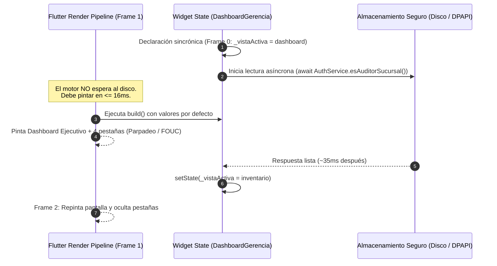

# Arquitectura de Sincronía, Asincronía y Gestión de Estados en Flutter

Este documento establece la guía técnica y conceptual sobre cómo gestionar operaciones **sincrónicas** y **asincrónicas** en Flutter, cómo evitar el parpadeo de interfaces (*FOUC / Layout Shift*) y cuáles son los estándares recomendados por la industria para aplicaciones móviles y de escritorio de nivel corporativo.

---

## 1. Fundamentos: Sincronía vs Asincronía en Dart y Flutter

### 1.1 Ejecución Sincrónica
* **Naturaleza:** Se ejecuta instrucción por instrucción de manera secuencial e inmediata en el hilo principal (*main isolate*).
* **Latencia:** Nanosegundos o microsegundos (acceso directo a registros de CPU y memoria RAM).
* **Ejemplos:**
  * Operaciones aritméticas y lógicas (`2 + 2`, `if (rol == 8)`).
  * Lectura de variables ya instanciadas en memoria RAM (`AuthService.cachedUser`).
  * Construcción de árboles de widgets estáticos o directos.

### 1.2 Ejecución Asincrónica (`async` / `await` / `Future`)
* **Naturaleza:** Involucra operaciones que dependen de recursos externos al procesador o de latencias no deterministas.
* **Mecanismo:** La función suspende temporalmente su ejecución en el punto del `await` y cede el control al **Event Loop** de Dart. Mientras la tarea externa concluye, la aplicación sigue respondiendo y dibujando fotogramas.
* **Ejemplos:**
  * Peticiones de red HTTP / REST / WebSockets.
  * Consultas a bases de datos SQLite / Supabase.
  * Lectura y escritura en disco seguro (`FlutterSecureStorage` en Windows DPAPI o Android KeyStore).

---

## 2. El Pipeline Gráfico de Flutter y el Origen del Parpadeo (FOUC)

Flutter renderiza interfaces a una cadencia objetivo de **60 a 120 fotogramas por segundo (FPS)**. Cada fotograma dispone de aproximadamente **16.6 milisegundos** para procesarse y pintarse en la GPU.



### ¿Por qué se produce el parpadeo visual?
1. **El ciclo de vida del Widget es sincrónico:** Cuando una pantalla se monta, Flutter ejecuta inmediatamente la declaración de variables y el primer `build()`.
2. **El motor no puede congelarse:** Si para decidir qué vista pintar se utiliza una función asincrónica (`await`), Flutter no se detiene a esperar el disco o la red. Pinta el primer frame con el valor por defecto que encuentre en memoria.
3. **El salto visual (*Layout Shift*):** Cuando el `await` finaliza varias decenas de milisegundos después y se ejecuta `setState()`, la interfaz cambia repentinamente ante los ojos del usuario.

En la industria, este comportamiento se denomina **FOUC (Flash of Unstyled Content)** o **Privilege Flicker**. En sistemas empresariales o financieros, se considera un defecto crítico porque puede filtrar visualmente opciones no autorizadas o degradar la confianza del usuario.

---

## 3. Estándares de la Industria: ¿Cuándo usar cada enfoque?

### Regla 1: La Identidad y los Permisos deben resolverse de forma Sincrónica (In-Memory Cache)
* **Principio:** El costo asíncrono de autenticación se paga **una sola vez** en la pantalla de acceso (Login / PIN / Enrolamiento) mediante un indicador de carga claro (*Spinner*).
* **Consecuencia:** Una vez que el backend valida las credenciales, el modelo de usuario resultante debe quedar fijado en la memoria RAM (*In-Memory State Container*).
* **Buenas Prácticas:**
  * Toda pantalla destino debe consultar la memoria RAM sincrónicamente (`0 ms`) al instanciar sus variables de estado.
  * Nunca consultar almacenamiento en disco con `await` para decidir el renderizado del primer fotograma si el usuario ya está autenticado en memoria.

### Regla 2: Cuándo usar Skeletons / Spinners vs Cuándo NO usarlos
* **SÍ usar Skeletons / Shimmers:**
  * Cuando se cargan **datos de negocio remotos** que aún no existen en el dispositivo (ej. listado de repuestos desde la API, gráficos de ventas del mes, historial de transacciones).
  * Comunica al usuario que la aplicación ya cargó su estructura y solo está esperando los datos del servidor.
* **NO usar Skeletons:**
  * Para averiguar **quién es el usuario** o **qué permisos tiene**. Provoca latencias artificiales innecesarias y sensación de lentitud en la navegación.

### Regla 3: Pre-calentamiento en Frío (*Splash Screen Gating*)
* Si la aplicación se inicia desde cero (*Cold Start*) restaurando una sesión persistida en disco:
  * El proceso de lectura asíncrona del disco debe realizarse durante la pantalla de bienvenida (**Splash Screen**) mientras se reproduce la animación de entrada.
  * Al momento de navegar a la vista principal, la memoria RAM ya debe estar completamente hidratada.

---

## 4. Comparativa de Patrones Arquitectónicos

| Patrón | Mecanismo | Latencia | Ventajas | Desventajas |
| :--- | :--- | :--- | :--- | :--- |
| **A. Caché Sincrónica en RAM (`cachedUser`)** *(Recomendado)* | La vista lee directamente un objeto en memoria viva al inicializarse. | **0 ms** | Cero parpadeo, componentes auto-contenidos, desacoplado de rutas. | Requiere mantener hidratado el modelo en login y splash. |
| **B. Inyección por Argumentos de Ruta** | `Navigator.pushNamed(..., arguments: {...})` pasa el rol o vista inicial. | **0 ms** | No depende de estado global. | Frágil: si la vista se abre desde otra vía (deep link, botón volver), debe repetirse la lógica. |
| **C. Lectura Asíncrona en `initState`** | `await storage.read()` dentro de `_cargarDatosIniciales()`. | **20 - 60 ms** | No requiere estado en memoria. | **Provoca FOUC**: muestra la vista incorrecta durante los primeros frames. |
| **D. Bloqueo con Skeleton / Spinner interno** | `_cargando = true` oculta la pantalla hasta que el `await` finalice. | **Variable** | Evita mostrar datos erróneos. | Sensación de lentitud innecesaria tras haber ingresado el PIN. |

---

## 5. Referencia de Implementación en el Proyecto

En esta base de código se implementó el **Patrón A (Caché Sincrónica en RAM con Pre-calentamiento en Splash)** en los siguientes módulos:

### 5.1 Servicio de Autenticación (`frontend/lib/features/auth/services/auth_service.dart`)
* Se definió la variable en memoria `static AuthUserModel? _currentUserCache`.
* Al ejecutar `loginConPin()` o `enrolarTerminal()`, la respuesta del backend hidrata inmediatamente `_currentUserCache`.
* Se implementó el getter sincrónico:
  ```dart
  static bool get esAuditorSucursalSync =>
      _currentUserCache != null &&
      _currentUserCache!.idRol == 8 &&
      _currentUserCache!.idSucursal != 1;
  ```

### 5.2 Vista de Gerencia (`frontend/lib/features/gerencia/presentation/screens/dashboard_gerencia_view.dart`)
* La inicialización de `_esAuditorSucursal` y `_vistaActiva` se desacopló del `Future` asíncrono y se vinculó al getter sincrónico:
  ```dart
  bool _esAuditorSucursal = AuthService.esAuditorSucursalSync;
  late VistaGerencia _vistaActiva = _esAuditorSucursal
      ? VistaGerencia.inventario
      : VistaGerencia.dashboard;
  ```
* En el método `initState()`, se reafirma la sincronía antes de encolar cualquier refresco de red.
* **Resultado:** El primer fotograma renderizado por Flutter monta directamente el módulo asignado sin transiciones bruscas ni parpadeos.

### 5.3 Arranque en Frío (`frontend/lib/features/auth/presentation/screens/splash_screen.dart`)
* En el método `_checkSession()`, durante el intervalo de animación del logo corporativo, se ejecuta `await AuthService.getAuthUser()`.
* Esto garantiza que, incluso si la aplicación se abre en frío con una sesión existente de días anteriores, la memoria RAM ya se encuentra poblada antes de despachar la ruta inicial.

### 5.4 Pruebas Unitarias (`frontend/test/login_test.dart`)
* Se agregaron pruebas deterministas validando que `AuthService.esAuditorSucursalSync` resuelva instantáneamente en RAM según el rol y la sucursal del usuario sin requerir acceso a disco.
