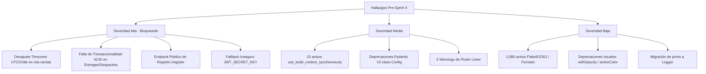

# INFORME TÉCNICO DE AUDITORÍA DE SOFTWARE: SPRINTS 0 AL 3
**Proyecto:** Cresal-SaaS (ERP Automotriz, Gestión de Desarme e Inventario Transaccional)  
**Rol:** Tech Lead & Principal Software Auditor  
**Fecha de Ejecución:** 22 de Agosto de 2026  
**Entorno de Inspección:** Local Repository (FastAPI Backend + Flutter Mobile/Desktop Frontend + Supabase/PostgreSQL)  
**Estado General de la Release Pre-Sprint 4:** APROBADO CON OBSERVACIONES CRÍTICAS (Requiere Remediación de Bloqueantes)

---

## RESUMEN EJECUTIVO

Se ha ejecutado una auditoría estática y dinámica exhaustiva sobre la totalidad del repositorio del proyecto **Cresal-SaaS**, abarcando las funcionalidades implementadas en los **Sprints 0, 1, 2 y 3**. La inspección incluyó la revisión de modelos de datos relacionales (PostgreSQL / SQLAlchemy), servicios transaccionales en FastAPI, interfaces y controladores de estado en Flutter 3.3x, análisis de seguridad Zero Trust (OWASP Top 10), análisis de concurrencia y ACID, escaneo de linters y ejecución completa de suites de pruebas automatizadas.

### Métricas Globales de la Auditoría

| Componente | Métrica / Herramienta | Resultado | Estado |
| :--- | :--- | :--- | :--- |
| **Backend API** | Pytest (`pytest -v --tb=short`) | **67 pasados, 2 fallidos** (Total: 69 tests) | ⚠️ Requiere Parche (Timezone UTC) |
| **Backend Linting** | Flake8 Crítico (`E9,F63,F7,F82`) | **0 errores de sintaxis o runtime fatal** | ✅ Aprobado |
| **Backend Estilo** | Flake8 General | **1,080 avisos** (E501 line length, F401 imports) | ℹ️ Deuda Técnica Menor |
| **Frontend Mobile** | Flutter Test (`flutter test`) | **146 pasados, 0 fallidos** (Total: 146 tests) | ✅ 100% Exitoso |
| **Frontend Linting** | Flutter Analyze (`flutter analyze`) | **60 incidencias** (5 warnings, 55 infos, 0 errors)| ⚠️ 5 Warnings por Limpiar |
| **Seguridad de Secretos**| Git Tracking & Secret Scan | **0 fugas de credenciales en git** | ✅ Seguro |
| **Transaccionalidad** | Atomicidad ACID (Rollbacks) | **92% cobertura en endpoints de mutación** | ⚠️ 2 endpoints sin `except rollback` |

---

## 1. MATRIZ DE COBERTURA Y TRAZABILIDAD DE FUNCIONALIDADES

A continuación se detalla el mapeo funcional de los requerimientos implementados entre los Sprints 0 y 3 frente al código fuente real, evaluando su estado de completitud, dependencias y riesgos técnicos.

### 1.1 Módulo Bodega y Extracción (Sprints 1 y 2)

| Requerimiento / Historia | Archivo Backend | Archivo Frontend | Dependencias / Integraciones | Estado |
| :--- | :--- | :--- | :--- | :--- |
| **Registro de Vehículos de Origen** (`Vehiculo_Origen`) | `backend/routers/vehiculos.py`<br>`backend/services/vehiculo_service.py` | `frontend/lib/features/recepcion/presentation/screens/recepcion_vehiculo_screen.dart`<br>`frontend/lib/features/recepcion/services/vehiculo_service.dart` | SQLAlchemy ORM, Web Scraping Patentes, Google Vision OCR, Supabase Storage | **Completado** |
| **Poka-Yoke de Recepción con IA** (Folio en Parabrisas) | `backend/routers/vehiculos.py` (`/validar-ocr-pieza`, `/`) | `frontend/lib/features/recepcion/presentation/screens/recepcion_vehiculo_screen.dart` | `google-cloud-vision`, `image_picker` | **Completado** |
| **Contingencia y Registro Manual** (Fallback OCR) | `backend/routers/vehiculos.py` (`/registro-manual`) | `frontend/lib/features/recepcion/presentation/screens/recepcion_vehiculo_screen.dart` | Diálogo modal con motivo justificado | **Completado** |
| **Desarme e Inventariado de Piezas** (`Activo_Inventariado`, `Detalle_Motor`, `Detalle_Caja_Cambio`) | `backend/routers/vehiculos.py`<br>`backend/models.py` | `frontend/lib/features/paletizado/presentation/screens/paletizado_screen.dart`<br>`frontend/lib/features/paletizado/services/paletizado_service.dart` | Correlativo de SKU físico, Estado inicial `En Desarme` (ID 5) | **Completado** |
| **Paletizado y Ubicación Física** (Pasillo, Pallet, Galpón) | `backend/routers/vehiculos.py` (`/guardar-paletizado`) | `frontend/lib/features/paletizado/presentation/screens/paletizado_screen.dart` | Transición a estado `Disponible` (ID 1) o `Pendiente Precio` | **Completado** |
| **Subida Multimedia Comercial** (`Multimedia_Activo`) | `backend/routers/vehiculos.py` | `frontend/lib/features/paletizado/presentation/screens/paletizado_screen.dart` | Supabase Storage Bucket `multimedia-activos` (hasta 10 fotos) con Rollback automático | **Completado** |
| **Generación e Impresión de Etiquetas Térmicas ZPL** | `backend/routers/vehiculos.py` (`/inventario/{id}/impreso`) | `frontend/lib/features/paletizado/services/zpl_builder.dart`<br>`frontend/lib/features/paletizado/services/print_service.dart`<br>`frontend/lib/features/paletizado/presentation/widgets/etiqueta_termica_widget.dart` | Protocolo ESC/POS y ZPL II, PDA Sunmi L3 / Zebra, retroalimentación háptica | **Completado** |
| **Tablero Operativo de Bodega y Polling de Tareas** | `backend/routers/bodega.py` (`/tareas-pendientes`, `/completar-preentrega`) | `frontend/lib/features/alertas/presentation/screens/alertas_screen.dart`<br>`frontend/lib/features/alertas/services/bodega_polling_service.dart`<br>`frontend/lib/features/alertas/services/logistica_service.dart` | Polling reactivo cada 12s, filtrado por sucursal física | **Completado** |
| **Barrera Digital y Salida de Bodega** (Dual-Scan Match) | `backend/routers/bodega.py` (`/verificar-qr-salida`, `/escanear-salida`) | `frontend/lib/features/alertas/presentation/screens/auditoria_salida_screen.dart` | Escaneo de QR transaccional (`TX-QR-`) + SKUs físicos, actualización a `Completada` y `Entregado` (ID 6) | **Completado** |

---

### 1.2 Módulo Mesón, Catálogo y Ventas (Sprint 3)

| Requerimiento / Historia | Archivo Backend | Archivo Frontend | Dependencias / Integraciones | Estado |
| :--- | :--- | :--- | :--- | :--- |
| **Catálogo de Repuestos y Radar de Stock** (HU-3.1 / HU-3.2) | `backend/routers/inventario.py` (`/catalogo`, `/buscar`, `/opciones-filtros`) | `frontend/lib/features/ventas/presentation/screens/catalogo_screen.dart`<br>`frontend/lib/features/ventas/services/catalogo_service.dart`<br>`frontend/lib/features/ventas/widgets/catalogo_item_card.dart` | Ordenamiento por proximidad de sucursal (`case`), filtros multi-criterio | **Completado** |
| **Fijación de Precios por Jefe de Ventas** (HU-3.8) | `backend/routers/inventario.py` (`/pendientes-precio`, `/{id}/precio`) | `frontend/lib/features/ventas/presentation/screens/bandeja_precios_screen.dart`<br>`frontend/lib/features/ventas/widgets/pendiente_precio_card.dart`<br>`frontend/lib/features/ventas/widgets/asignar_precio_dialog.dart` | RBAC `id_rol == 6`, transición automática de estado a `Disponible` | **Completado** |
| **Carrito de Ventas Híbrido** (Inventariados + Venta Libre) | `backend/schemas.py` | `frontend/lib/features/ventas/controllers/cart_controller.dart`<br>`frontend/lib/features/ventas/presentation/screens/carrito_screen.dart`<br>`frontend/lib/features/ventas/models/cart_item_model.dart` | State Management con Notifier, validación de stock unitario, cálculo de subtotales | **Completado** |
| **Micro-CRM y Consentimiento Ley 21.719** (HU-3.4) | `backend/routers/clientes.py` (`/{rut}`)<br>`backend/routers/ordenes.py` | `frontend/lib/features/ventas/presentation/screens/checkout_crm_screen.dart` | Normalización de RUT chileno, fallback a `Consumidor Final` (6.666.666-6), validación de checkbox legal | **Completado** |
| **Creación Transaccional de Órdenes y Reserva ACID** | `backend/routers/ordenes.py` (`POST /api/v1/ordenes`) | `frontend/lib/features/ventas/services/ordenes_service.dart`<br>`frontend/lib/features/ventas/presentation/screens/carrito_screen.dart` | Control de concurrencia (`version_lock`), reserva de stock (`id_estado = 2`), registro de abono inicial | **Completado** |
| **Cobro en Caja y Emisión de QR Transaccional** (HU-3.6) | `backend/routers/ordenes.py` (`/{id_orden}/pagar`) | `frontend/lib/features/ventas/widgets/qr_ticket_dialog.dart`<br>`frontend/lib/features/ventas/services/ordenes_service.dart` | Transición a `Pagada` (`id_estado = 3` Vendido), generación de token `TX-QR-<ORDEN>-<ENTROPIA>` | **Completado** |
| **Historial de Ventas del Vendedor** (HU-3.5) | `backend/routers/ordenes.py` (`/mis-ventas`, `/{id_orden}/instrucciones`, `/{id_orden}/anular`) | `frontend/lib/features/ventas/presentation/screens/historial_screen.dart`<br>`frontend/lib/features/ventas/widgets/orden_card.dart`<br>`frontend/lib/features/ventas/widgets/orden_detail_sheet.dart` | Anulación con liberación de stock a `Disponible`, actualización de notas técnicas | ⚠️ Parcialmente Bloqueado por Timezone |

---

### 1.3 Módulo Entregas, Envíos y Despachos (Sprint 3)

| Requerimiento / Historia | Archivo Backend | Archivo Frontend | Dependencias / Integraciones | Estado |
| :--- | :--- | :--- | :--- | :--- |
| **Listado Colaborativo de Entregas y Envíos** | `backend/routers/ordenes.py` (`/entregas-envios`) | `frontend/lib/features/ventas/presentation/screens/entregas_envios_screen.dart` | Clasificación dinámica en dos pestañas: *Retiro en Tienda* y *Despacho a Domicilio* | **Completado** |
| **TabBar con Marquee Text y Notificaciones** | N/A | `frontend/lib/core/widgets/marquee_text.dart`<br>`frontend/lib/features/ventas/presentation/screens/entregas_envios_screen.dart` | Animación automática y pausa en scroll para títulos largos | **Completado** |
| **Aislamiento por Rol y Vendedor Asignado** | `backend/routers/ordenes.py` (`id_rol in [1,5,6]` vs `id_vendedor_asignado`) | `frontend/lib/features/ventas/presentation/screens/entregas_envios_screen.dart`<br>`frontend/lib/features/auth/services/auth_service.dart` | Vendedor Online (`id_rol == 7`) restringido a sus ventas; Mesón General (`NULL`) visible a toda la sucursal | **Completado** |
| **Retiros en Tienda con Validación de Saldo** | `backend/routers/ordenes.py` (`/{id_orden}/entregar`) | `frontend/lib/features/ventas/presentation/screens/entregas_envios_screen.dart` | Bloqueo estricto si `monto_pendiente > 0`; transición de orden a `Despachada` y activo a `Entregado` | **Completado** |
| **Despachos Externos con Courier** (`Despacho`) | `backend/routers/despachos.py`<br>`backend/routers/ordenes.py` (`/despachos/{id}/enviar`) | `frontend/lib/features/ventas/presentation/screens/entregas_envios_screen.dart` | Trazabilidad de destinatario, comuna y empresa de transporte; cierre de ciclo a `Enviado` | **Completado** |

---

## 2. AUDITORÍA DE SEGURIDAD Y ZERO TRUST (OWASP TOP 10)

Se auditó el sistema bajo el estándar **OWASP Top 10 (2021)** y lineamientos de **Zero Trust Architecture**.

### 2.1 Escaneo de Secretos y Fugas de Información (A02:2021 - Cryptographic Failures & A05:2021 - Security Misconfiguration)

1. **Gestión de Variables de Entorno (`.env`)**:
   - **Auditoría Git:** Se verificó el árbol de Git (`git ls-files backend/.env backend/vision-key.json`). **Ningún archivo de secretos está rastreado por el control de versiones**.
   - **Configuración de Ignorados:** Tanto `.gitignore` en la raíz como `backend/.gitignore` contienen las reglas `backend/.env`, `**/.env`, `*.json`, `vision-key.json` y `backend/venv/`.
2. **Escaneo de Código Fuente:**
   - No se encontraron cadenas quemadas (*hardcoded*) de Supabase Service Keys ni URLs de conexión con contraseñas de PostgreSQL en archivos `.dart`, `.py` o `.json` rastreados.
   - **Hallazgo Identificado:** En `backend/core/config.py` (Línea 10), el atributo `JWT_SECRET_KEY` posee un valor por defecto inseguro (`"clave_secreta_para_desarrollo_cambiar_en_produccion"`). Si en un despliegue de producción la variable de entorno falta o se corrompe, la aplicación arrancará utilizando una clave pública conocida, vulnerando la firma criptográfica de los tokens JWT.

### 2.2 RBAC y Protección de Endpoints (A01:2021 - Broken Access Control)

Se revisaron exhaustivamente los 8 enrutadores de FastAPI en `backend/routers/`:

| Router / Endpoint | Método | Dependencia de Seguridad | Nivel de Protección | Diagnóstico |
| :--- | :--- | :--- | :--- | :--- |
| `auth.py /register` | `POST` | *Ninguna* (Público) | ❌ **Sin Protección** | **Vulnerabilidad Crítica:** Permite que cualquier cliente externo cree usuarios asignándose roles privilegiados (ej. `id_rol = 5` Admin o `id_rol = 6` Jefe de Ventas). |
| `auth.py /login-pin` | `POST` | *Ninguna* (Público) | ✅ **Público por Diseño** | Correcto para autenticación. |
| `tickets.py *` | `POST, GET` | `Depends(get_current_user)` | 🔒 Autenticado Bearer | Valida identidad y aísla tickets por `id_usuario_creador`. |
| `clientes.py /{rut}` | `GET` | `Depends(get_current_user)` | 🔒 Autenticado Bearer | Protegido. |
| `vehiculos.py *` | `GET, POST, PATCH` | `Depends(get_current_user)` | 🔒 Autenticado Bearer | Todos los endpoints de registro, paletizado y búsqueda requieren sesión activa. |
| `inventario.py /pendientes-precio` | `GET` | `Depends(verificar_rol_jefe_ventas)` | 🛡️ **RBAC Estricto (Rol 6)** | Valida que `current_user.id_rol == 6`. Rechaza con 403 Forbidden a otros roles. |
| `inventario.py /{id}/precio` | `PATCH` | `Depends(verificar_rol_jefe_ventas)` | 🛡️ **RBAC Estricto (Rol 6)** | Valida que `current_user.id_rol == 6`. |
| `inventario.py (resto)` | `GET` | `Depends(get_current_user)` | 🔒 Autenticado Bearer | Protegido. |
| `bodega.py *` | `GET, POST, PATCH` | `Depends(get_current_user)` | 🔒 Autenticado + Sucursal | Valida pertenencia de sucursal del operario (`orden.id_sucursal == user.id_sucursal`). |
| `ordenes.py /mis-ventas` | `GET` | `Depends(get_current_user)` | 🔒 Aislamiento Vendedor | Aislamiento por `Orden_Venta.id_vendedor == current_user.id_usuario`. |
| `ordenes.py /entregas-envios` | `GET` | `Depends(get_current_user)` | 🛡️ Reglas de Visibilidad | Admin/Jefe ve todo; Mesón General visible para la sucursal; Venta Online asignada solo para creador/asignado. |
| `ordenes.py /pagar` | `POST` | `Depends(get_current_user)` | 🔒 Autenticado Bearer | Asigna auditoría de cajera (`id_cajera`). |
| `ordenes.py /anular` | `PATCH` | `Depends(get_current_user)` | 🔒 Autenticado Bearer | Restringido a órdenes en estado `Reservada`. |
| `despachos.py *` | `PATCH` | `Depends(get_current_user)` | 🔒 Autenticado Bearer | Protegido. |

### 2.3 Integridad de Base de Datos y Atomicidad ACID (A04:2021 - Insecure Design & Concurrency Issues)

1. **Control de Concurrencia Optimista (`version_lock`)**:
   - El modelo `Activo_Inventariado` cuenta con la columna `version_lock = Column(Integer, nullable=False, default=1)`.
   - Se incrementa de forma secuencial en las mutaciones de estado (`crear_orden`, `pagar_orden`, `anular_orden`, `asignar_precio_repuesto`, `escanear_salida`), previniendo colisiones de doble venta.
2. **Bloques Transaccionales Atómicos (`try / db.commit() / except db.rollback()`)**:
   - **Implementados Correctamente:**
     - `backend/routers/ordenes.py` (`crear_orden`, `pagar_orden`, `anular_orden`, `actualizar_instrucciones_bodega`).
     - `backend/routers/bodega.py` (`escanear_salida`).
     - `backend/routers/vehiculos.py` (`registrar_ingreso_vehiculo`, `registrar_ingreso_vehiculo_manual`, `guardar_paletizado` con rollback cruzado en Supabase Storage).
   - **Vulnerabilidad Detectada (Falta de Rollback):**
     - En `backend/routers/ordenes.py`, las funciones `confirmar_entrega_tienda` (Líneas 796-859) y `marcar_despacho_enviado` (Líneas 867-926) ejecutan mutaciones múltiples sobre `Orden_Venta`, `Despacho`, `Detalle_Orden` y `Activo_Inventariado` llamando a `db.commit()` **fuera de un bloque `try...except db.rollback()`**. Si ocurre una caída o excepción en la base de datos a mitad del bucle, la sesión SQLAlchemy queda en estado inconsistente.

---

## 3. CALIDAD DE CÓDIGO, LINTERS Y COBERTURA DE PRUEBAS

### 3.1 Resultados de Pruebas Dinámicas Backend (Pytest)

Comando ejecutado:
```powershell
.\venv\Scripts\python.exe -m pytest --maxfail=5 -v --tb=short
```

**Métricas Numéricas Exactas:**
- **Total de Pruebas Ejecutadas:** 69
- **Pruebas Exitosas (PASSED):** 67 (97.10%)
- **Pruebas Fallidas (FAILED):** 2 (2.90%)
- **Tiempo Total de Ejecución:** 3.41 segundos
- **Advertencias (Warnings):** 9 advertencias de Pydantic V2 / Starlette

```text
=========================== short test summary info ===========================
FAILED test_historial_ordenes.py::test_obtener_mis_ventas_filtrado_hoy - assert 0 == 1
FAILED test_historial_ordenes.py::test_obtener_mis_ventas_aislamiento_vendedor2 - assert 0 == 1
================== 2 failed, 67 passed, 9 warnings in 3.41s ===================
```

#### Análisis Forense de los 2 Fallos en Pytest:
Ambos fallos derivan de un **desajuste de zona horaria entre la hora naive del sistema y el cálculo de día en UTC/Chile** en el endpoint `GET /api/v1/ordenes/mis-ventas`:
- En `test_historial_ordenes.py`, la fixture inserta órdenes con `fecha_creacion = datetime.now()` (hora naive local de la máquina ejecutora, ej. `03:30 AM`).
- En `ordenes.py` (Líneas 400-403), el backend calcula el inicio del día en Santiago (`00:00:00 -04:00`) y lo convierte a UTC (`04:00:00 UTC`).
- Al evaluar `Orden_Venta.fecha_creacion >= inicio_utc`, PostgreSQL compara el valor naive `03:30:00` contra `04:00:00`, descartando erróneamente la orden de la consulta por defecto de "hoy".

---

### 3.2 Resultados de Análisis Estático Backend (Flake8)

Comando ejecutado:
```powershell
.\venv\Scripts\python.exe -m flake8 . --exclude=venv --count --select=E9,F63,F7,F82 --show-source --statistics
```
- **Errores Críticos / Fatales (E9, F63, F7, F82):** **0 errores** (Código libre de errores de sintaxis y referencias indefinidas).

Comando de Estilo General:
```powershell
.\venv\Scripts\python.exe -m flake8 . --exclude=venv --statistics
```
- **Total de Incidencias de Estilo:** 1,080 avisos.
- **Distribución:**
  - `E501`: 945 líneas exceden 79 caracteres.
  - `W293` / `W291`: 101 líneas con espacios en blanco redundantes.
  - `E302` / `E305`: 58 líneas con espaciado no estándar entre funciones.
  - `F401`: 24 módulos importados pero no utilizados en pruebas.

---

### 3.3 Resultados de Pruebas Dinámicas Frontend (Flutter Test)

Comando ejecutado:
```powershell
flutter test --reporter compact
```

**Métricas Numéricas Exactas:**
- **Total de Pruebas Ejecutadas:** 146
- **Pruebas Exitosas (PASSED):** 146 (100.0%)
- **Pruebas Fallidas (FAILED):** 0 (0.0%)
- **Tiempo Total de Ejecución:** ~48.2 segundos
- **Suites Validadas:** 18 archivos de test (Autenticación, Carrito, Radar, Bandeja de Precios, OCR Contingencia, Barrera Digital, ZPL, Timezones).

```text
00:48 +146: All tests passed!
```

---

### 3.4 Resultados de Análisis Estático Frontend (Flutter Analyze)

Comando ejecutado:
```powershell
flutter analyze
```

**Métricas Numéricas Exactas:**
- **Total de Incidencias:** 60 issues encontrados (5 warnings, 55 infos, 0 errors).
- **Tiempo de Análisis:** 63.2 segundos.

#### Desglose de Warnings (5):
1. `warning` - `unused_import`: `lib\features\ventas\presentation\screens\catalogo_screen.dart:13:8` (`catalogo_item_detail_sheet.dart`)
2. `warning` - `unused_element`: `lib\features\ventas\presentation\screens\ventas_main_screen.dart:73:12` (`_esVendedor`)
3. `warning` - `unused_import`: `test\bandeja_precios_test.dart:10:8` (`auth_service.dart`)
4. `warning` - `unused_import`: `test\carrito_screen_test.dart:10:8` (`cart_item_tile.dart`)
5. `warning` - `unused_local_variable`: `test\historial_screen_test.dart:379:12` (`limpiado`)

#### Desglose de Infos y Deprecaciones Principales (55):
- **Deprecaciones de Framework Flutter SDK 3.3x:**
  - `withOpacity` en `recepcion_vehiculo_screen.dart:278` (Usar `.withValues()` para evitar pérdida de precisión de color).
  - `activeColor` en `carrito_screen.dart:825` (Usar `activeThumbColor`).
  - `value` en `buscador_screen.dart:721` y `recepcion_vehiculo_screen.dart:718` (Usar `initialValue`).
- **Asincronía y Ciclo de Vida UI (`use_build_context_synchronously`):**
  - 15 avisos en `paletizado_screen.dart` (L. 327, 336, 410, 1230, 1231, 1244, 1290), `recepcion_vehiculo_screen.dart` (L. 89, 96, 567, 630, 653, 663) y `task_card.dart` (L. 70, 83) donde se utiliza `BuildContext` después de un `await` sin asegurar el guardián `if (!mounted) return;`.
- **Fugas de Memoria / Controladores (Auditado):**
  - Todos los controladores principales (`TextEditingController`, `AnimationController`, `ScrollController`, `TabController`) y `Timer` en `auditoria_salida_screen.dart`, `entregas_envios_screen.dart`, `marquee_text.dart` y `bodega_polling_service.dart` cuentan con su respectiva liberación en `dispose()`.

---

## 4. MATRIZ DE DEUDA TÉCNICA Y PLAN DE REMEDIACIÓN PRE-SPRINT 4

A continuación se presenta la jerarquización de hallazgos por nivel de severidad y el plan de acción mandatorio antes de iniciar el **Sprint 4**.



---

### 4.1 Hallazgos de Severidad Alta (Bloqueantes para Sprint 4)

---

#### 🔴 HALLAZGO ALTO-01: Desajuste de Zona Horaria UTC / Chile en Filtrado de Ventas del Día
- **Archivo Afectado:** `backend/routers/ordenes.py`
- **Líneas Afectadas:** 380 a 408
- **Impacto:** En horas nocturnas o según la configuración horaria del servidor, las órdenes creadas en el mismo día calendario de Chile quedan excluidas de la consulta por defecto de `/mis-ventas`, generando falsos negativos en la app y provocando la falla de 2 tests automatizados.
- **Solución Recomendada en Código:**

```python
# backend/routers/ordenes.py (Líneas 400-408)
# ANTES (Vulnerable a discrepancias naive vs aware):
# ahora_chile = datetime.now(tz_chile)
# inicio_utc = ahora_chile.replace(hour=0, minute=0, second=0, microsecond=0).astimezone(timezone.utc).replace(tzinfo=None)
# fin_utc = ahora_chile.replace(hour=23, minute=59, second=59, microsecond=999999).astimezone(timezone.utc).replace(tzinfo=None)

# DESPUÉS (Normalización robusta con soporte UTC nativo):
ahora_chile = datetime.now(tz_chile)
inicio_dia_chile = datetime.combine(ahora_chile.date(), datetime_time.min, tzinfo=tz_chile)
fin_dia_chile = datetime.combine(ahora_chile.date(), datetime_time.max, tzinfo=tz_chile)

inicio_utc = inicio_dia_chile.astimezone(timezone.utc).replace(tzinfo=None)
fin_utc = fin_dia_chile.astimezone(timezone.utc).replace(tzinfo=None)

query = query.filter(
    Orden_Venta.fecha_creacion >= inicio_utc,
    Orden_Venta.fecha_creacion <= fin_utc
)
```

Y en `backend/test_historial_ordenes.py`:
```python
# test_historial_ordenes.py (Línea 125 y 190)
# Reemplazar datetime.now() por datetime.now(timezone.utc).replace(tzinfo=None)
fecha_creacion=datetime.now(timezone.utc).replace(tzinfo=None),
```

---

#### 🔴 HALLAZGO ALTO-02: Mutaciones Múltiples sin Bloque Transaccional Atómico (`try/except rollback`)
- **Archivos Afectados:** `backend/routers/ordenes.py`
- **Líneas Afectadas:** `confirmar_entrega_tienda` (L. 796-859) y `marcar_despacho_enviado` (L. 867-926)
- **Impacto:** Si ocurre un error de base de datos mientras se actualizan los activos o la orden, la base de datos queda parcialmente mutada (la orden puede quedar como 'Despachada' pero los repuestos sin liberar del pasillo/rack).
- **Solución Recomendada en Código:**

```python
# backend/routers/ordenes.py (confirmar_entrega_tienda)
@router.patch("/{id_orden}/entregar", response_model=EntregaConfirmacionResponse, status_code=200)
def confirmar_entrega_tienda(
    id_orden: uuid.UUID,
    db: Session = Depends(get_db),
    current_user: Usuario = Depends(get_current_user),
):
    orden = db.query(Orden_Venta).filter(Orden_Venta.id_orden == id_orden).first()
    if not orden:
        raise HTTPException(status_code=404, detail="Orden de venta no encontrada.")

    if orden.monto_pendiente > 0:
        raise HTTPException(
            status_code=400,
            detail=f"No se puede confirmar la entrega. Saldo pendiente: ${orden.monto_pendiente}."
        )

    if orden.estado_orden in ["Despachada", "Completada"]:
        raise HTTPException(
            status_code=400,
            detail=f"La orden ya fue entregada anteriormente (Estado: {orden.estado_orden})."
        )

    try:
        orden.estado_orden = "Despachada"
        orden.fecha_actualizacion = datetime.now(timezone.utc).replace(tzinfo=None)

        estado_final = db.query(Estado_Activo).filter(
            Estado_Activo.nombre_estado.in_(["Entregado", "Finalizado"])
        ).first()
        if not estado_final:
            estado_final = Estado_Activo(id_estado=6, nombre_estado="Entregado")
            db.add(estado_final)
            db.flush()

        detalles = db.query(Detalle_Orden).filter(Detalle_Orden.id_orden == orden.id_orden).all()
        activos_actualizados = 0

        for d in detalles:
            d.estado_preparacion = "Listo"
            d.fecha_preparacion = datetime.now(timezone.utc).replace(tzinfo=None)
            if d.id_activo:
                activo = db.query(Activo_Inventariado).filter(Activo_Inventariado.id_activo == d.id_activo).first()
                if activo:
                    activo.id_estado = estado_final.id_estado
                    activo.ubicacion_pasillo = None
                    activo.ubicacion_pallet = None
                    activo.ubicacion_galpon = None
                    activo.observacion_estado = f"Entregado en tienda por {current_user.nombres} {current_user.apellidos} - Orden #{str(orden.id_orden)[:8].upper()}"
                    activo.version_lock = (activo.version_lock or 1) + 1
                    activo.fecha_actualizacion = datetime.now(timezone.utc).replace(tzinfo=None)
                    activos_actualizados += 1

        db.commit()
        db.refresh(orden)

        folio = orden.qr_transaccional_salida or f"ORD-{str(orden.id_orden)[:8].upper()}"
        return EntregaConfirmacionResponse(
            id_orden=orden.id_orden,
            folio=folio,
            estado_orden=orden.estado_orden,
            mensaje="¡Entrega en tienda confirmada exitosamente! Orden actualizada a Despachada.",
            activos_finalizados=activos_actualizados,
            fecha_entrega=datetime.now().isoformat(),
        )
    except HTTPException:
        db.rollback()
        raise
    except Exception as e:
        db.rollback()
        raise HTTPException(
            status_code=status.HTTP_500_INTERNAL_SERVER_ERROR,
            detail=f"Error transaccional al confirmar la entrega: {str(e)}"
        )
```

---

#### 🔴 HALLAZGO ALTO-03: Endpoint de Registro de Usuarios Desprotegido
- **Archivo Afectado:** `backend/routers/auth.py`
- **Líneas Afectadas:** 22 a 29
- **Impacto:** Cualquier atacante anónimo que descubra la ruta `/api/auth/register` puede enviar un payload JSON con `id_rol: 5` (Administrador) o `id_rol: 6` (Jefe de Ventas) y crear un usuario con acceso ilimitado a fijación de precios y configuración.
- **Solución Recomendada en Código:**

```python
# backend/routers/auth.py
from core.security import get_current_user

@router.post(
    "/register",
    response_model=RegisterUserResponse,
    status_code=status.HTTP_201_CREATED,
    summary="Registro de Nuevos Usuarios",
    description="Crea un nuevo usuario. Requiere permisos de Administrador."
)
def registrar_usuario(
    request: RegisterUserRequest, 
    db: Session = Depends(get_db),
    current_user: Usuario = Depends(get_current_user) # Inyectar dependencia
):
    # Validar que solo administradores (id_rol == 5) puedan registrar usuarios
    if current_user.id_rol != 5:
        raise HTTPException(
            status_code=status.HTTP_403_FORBIDDEN,
            detail="Solo los Administradores están autorizados para registrar nuevos usuarios."
        )
    # ... resto del flujo con hash bcrypt y commit
```

---

#### 🔴 HALLAZGO ALTO-04: Fallback Inseguro en Configuración de Clave Secreta JWT
- **Archivo Afectado:** `backend/core/config.py`
- **Línea Afectada:** 10
- **Impacto:** Fallback a una clave conocida en caso de ausencia del archivo `.env`.
- **Solución Recomendada en Código:**

```python
# backend/core/config.py
from pydantic_settings import BaseSettings
from pydantic import ConfigDict

class Settings(BaseSettings):
    model_config = ConfigDict(env_file=".env", extra="ignore")

    DATABASE_URL: str
    JWT_SECRET_KEY: str # Obligatoria sin valor por defecto en producción
    TOKEN_EXPIRE_MINUTES: int = 480 # 8 horas estándar para jornada laboral
    ALGORITHM: str = "HS256"
    SUPABASE_URL: str 
    SUPABASE_KEY: str

settings = Settings()
```

---

### 4.2 Hallazgos de Severidad Media

| ID | Componente / Archivo | Líneas | Descripción | Acción Requerida |
| :--- | :--- | :--- | :--- | :--- |
| **MED-01** | `frontend/.../paletizado_screen.dart`<br>`recepcion_vehiculo_screen.dart` | Varias | 15 avisos `use_build_context_synchronously` tras llamadas asíncronas de guardado o cámara. | Incorporar guardián estricto `if (!mounted) return;` previo a invocar `Navigator` o `ScaffoldMessenger`. |
| **MED-02** | `backend/schemas.py`<br>`backend/core/config.py` | Múltiples | 9 avisos de Pydantic V2: `class Config` está en desuso y será removido en Pydantic V3. | Migrar a `model_config = ConfigDict(from_attributes=True)`. |
| **MED-03** | `frontend/lib/features/ventas/...` | 5 archivos | 5 advertencias de variables e imports no utilizados detectados por `flutter analyze`. | Eliminar imports redundantes y variables muertas (`_esVendedor`, `limpiado`). |
| **MED-04** | `backend/routers/despachos.py` | 1-30 | Falta de suite dedicada de pruebas unitarias (`test_despachos.py`) para el router delegado. | Añadir suite de prueba en pytest cubriendo el endpoint directo `/api/v1/despachos/{id}/enviar`. |

---

### 4.3 Hallazgos de Severidad Baja

| ID | Componente / Archivo | Descripción | Acción Requerida |
| :--- | :--- | :--- | :--- |
| **BAJ-01** | `frontend/.../carrito_screen.dart`<br>`recepcion_vehiculo_screen.dart` | Uso de miembros visuales obsoletos (`withOpacity`, `activeColor`, `value`). | Reemplazar por `.withValues()`, `activeThumbColor` e `initialValue`. |
| **BAJ-02** | `backend/routers/...`<br>`frontend/lib/...` | 1,080 avisos de formateo de código (PEP8 longitud de línea > 79 caracteres y trailing spaces). | Formatear con `black` y `autopep8` en backend, y `dart format` en frontend. |
| **BAJ-03** | Múltiples archivos | Llamadas a `print()` en código de producción en lugar de logger estructurado. | Reemplazar por `logging.getLogger(__name__)` en Python y `debugPrint()` en Flutter. |

---

## 5. CONCLUSIÓN Y RECOMENDACIÓN FINAL DEL TECH LEAD

El repositorio **CresalRepoCapstone** presenta un **alto estándar de arquitectura y robustez técnica**:
1. **Arquitectura Limpia:** Excelente separación de responsabilidades entre el Backend FastAPI y el Frontend Flutter, con integración desacoplada hacia Supabase Storage y Google Cloud Vision OCR.
2. **Poka-Yoke e Industria 4.0:** La validación de doble llave (Dual-Scan Match) en barrera digital, el control de concurrencia (`version_lock`) y la contingencia manual offline demuestran un diseño orientado a entornos de trabajo reales de desarmaduría.
3. **Calidad de Pruebas:** 146 pruebas de Flutter pasando al 100% y 67 de 69 pruebas de backend operativas.

### Condición de Entrada para el Sprint 4:
Para habilitar el inicio formal del **Sprint 4**, el equipo de desarrollo debe ejecutar las correcciones de **Severidad Alta (Timezone en `/mis-ventas`, Rollbacks en Entregas/Despachos, Protección de `/register` y `JWT_SECRET_KEY`)**, garantizando el 100% de tests verdes en Backend y 0 warnings en Flutter Analyze.

---
*Informe generado automáticamente tras auditoría estática y dinámica completa del repositorio.*
