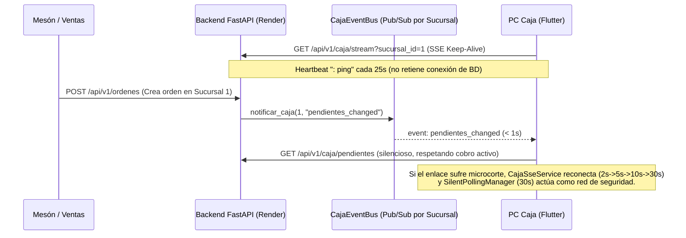

# DOCUMENTACIÓN TÉCNICA: OPTIMIZACIÓN DE CONSULTAS SQL, CERO N+1 Y SINCRONIZACIÓN HÍBRIDA SSE EN CAJA

> **Módulos Afectados:** Backend (`database.py`, `caja.py`, `ordenes.py`, `caja_events.py`) y Frontend (`CajaMainScreen`, `HistorialCajaScreen`, `HistorialCajaProvider`, `CajaSseService`).  
> **Fecha de Documentación:** Noviembre 2026  
> **Estado:** Implementado y Verificado  
> **Relación:** Complementa a [DOCUMENTACION_RESILIENCIA_RED_Y_HANDSHAKE.md](../entregas/DOCUMENTACION_RESILIENCIA_RED_Y_HANDSHAKE.md) y actualiza la sección de Caja en [SISTEMA-DE-REFRESCOS-POR-ROL.md](../specs/historias_usuario/SISTEMA-DE-REFRESCOS-POR-ROL.md).

---

## 1. Contexto y Diagnóstico del Problema

En producción (sucursal Cresal, enlace Ethernet sobre plan básico Entel de ~10–50 Mbps) y en pruebas controladas contra Render (`Virginia US East`) + Supabase (`São Paulo sa-east-1`), el **Módulo de Caja** presentaba demoras superiores a **30–45 segundos** e interrupciones de conexión al consultar el **Historial de Órdenes**, afectando también el cambio entre pestañas. En contraste, el módulo de **Gerencia** bajo la misma red respondía con fluidez.

### Mediciones Reales de Reproducción ("Antes")
* **1 orden en el período:** ~1 segundo (funcionaba bien).
* **19 órdenes en el rango:** **12,06 segundos** (incluso sobre fibra óptica y con Render ya despierto).
* **77+ registros (50+ agregados en BD de pruebas):** **43,99 segundos**, superando el timeout HTTP de 35s del cliente y mostrando error de conexión.

---

## 2. Anatomía de las Causas Raíz

El problema no radicaba en el ancho de banda del plan Entel, sino en la combinación de **3 cuellos de botella en código** amplificados por la latencia física cruzada entre **Render (Virginia)** y **Supabase (São Paulo)** (~120–150 ms de ida y vuelta por cada consulta SQL secuencial):

### A. Problema Masivo N+1 sin Paginación SQL en Backend (`caja.py`)
1. **`GET /api/v1/caja/historial`:**
   * Traía **todas** las órdenes del período a memoria (`.all()`, sin `OFFSET`/`LIMIT` en SQL) y recién recortaba los 20 ítems de la página al final en Python.
   * Dentro de un bucle `for` ejecutaba **4 consultas SQL secuenciales por cada orden** del período completo (`Transaccion_Pago`, `Detalle_Orden` con 5 `OUTER JOIN`s, `Auditoria_Barrera` y `Auditoria_Edicion_Pago`).
   * Además, aplicaba filtros de búsqueda multicriterio y cálculo del `resumen_cuadre` iterando en Python sobre toda la lista.
   * Con 19 órdenes ejecutaba **~78 viajes secuenciales** (~12s); con 77+ órdenes superaba los **300 viajes** (>40s, gatillando timeout en `ApiService`).
2. **`GET /api/v1/caja/pendientes` (Bandeja de Órdenes Nuevas, Abonadas y Backorders):**
   * Ejecutaba **2 queries secuenciales por cada venta pendiente** y **2 queries por cada reserva backorder**, escalando linealmente con el volumen de la bandeja.
3. **`POST /api/v1/caja/cobros/registrar` y `GET /api/v1/ordenes`:**
   * Mini N+1 al actualizar activos por ítem en órdenes mixtas (`caja.py`) y al consultar `Auditoria_Edicion_Pago` por orden en Gerencia (`ordenes.py`).

### B. Espiral de Peticiones Apiladas en Frontend (`CajaMainScreen` y `HistorialCajaProvider`)
1. **Polling cada 3 segundos sin `await`:** `CajaMainScreen` ejecutaba `SilentPollingManager` cada **3s** e invocaba `_historialKey.currentState?.refrescarSilencioso()` (que retornaba `void`, sin `await`). Al superar los 3s de respuesta, el timer disparaba una nueva petición `GET /historial` cada 3s en paralelo sin esperar la anterior.
2. **Descarte mutuo por `_currentRequestId`:** Cada refresco silencioso incrementaba `_currentRequestId`, descartando la respuesta de la consulta manual que el usuario estaba esperando y dejando el spinner bloqueado indefinidamente.
3. **Carga ansiosa al arrancar:** `IndexedStack` instanciaba simultáneamente la Bandeja de Cobros, el Historial y Soporte Técnico al iniciar sesión, disparando peticiones múltiples de entrada aunque la cajera solo estuviera mirando Cobros.
4. **Pantalla en blanco al paginar o filtrar:** `HistorialCajaScreen` ocultaba la tabla completa y mostraba un `CircularProgressIndicator` centrado cada vez que cambiaba de página o filtro.

---

## 3. Arquitectura de la Solución Implementada

### 3.1 Backend: Consultas `O(1)` y Pool Resiliente

| Archivo / Endpoint | Cambio Implementado | Impacto |
| :--- | :--- | :--- |
| [database.py](../../backend/database.py) | Se configuró `pool_pre_ping=True`, `pool_recycle=300`, `pool_size=5` y `max_overflow=10` para PostgreSQL/Supabase (manteniendo SQLite para tests). | Evita errores por sockets cerrados o inactivos hacia Supabase. |
| [caja.py](../../backend/routers/caja.py) (`GET /historial`) | Filtros (búsqueda multicriterio y método de pago normalizado en SQL con `_normalize_accents_sql`), conteo + cálculo de `resumen_cuadre` vía agregación SQL (`SUM`/`CASE`/`COUNT`), paginación real en SQL (`OFFSET`/`LIMIT`) y carga en lote con `.in_(orden_ids)` solo para los ≤20 registros de la página. | De **4×N** queries a **≤10 queries fijas** sin importar cuántas órdenes existan. |
| [caja.py](../../backend/routers/caja.py) (`GET /pendientes`) | Pre-carga en lote con `.in_(all_orden_ids)` y `.in_(reserva_ids_bo)` para detalles y abonos de ventas nuevas, abonadas y backorders. | De **2×N** queries a **≤8 queries fijas**. |
| [caja.py](../../backend/routers/caja.py) (`POST /cobros/registrar`) | Actualización de `Activo_Inventariado` en órdenes mixtas mediante carga previa en lote con `.in_(activo_ids)`. | Elimina consultas por ítem al liquidar órdenes mixtas. |
| [ordenes.py](../../backend/routers/ordenes.py) (`GET /api/v1/ordenes`) | Pre-carga en lote de `Auditoria_Edicion_Pago` con `.in_(orden_ids)`. | Cierra el último N+1 en el visor gerencial. |

### 3.2 Sincronización Híbrida en Tiempo Real: Push SSE + Respaldo 30s

Para cumplir con el flujo operativo real de la sucursal (~10 segundos de caminata del cliente desde mesón a caja) **sin obligar a la cajera a pulsar "Actualizar"** y sin saturar la red Entel con polling agresivo, se implementó una arquitectura híbrida sin dependencias externas:

* **Backend ([caja_events.py](../../backend/services/caja_events.py) + `GET /api/v1/caja/stream` en [caja.py](../../backend/routers/caja.py)):**
  * `CajaEventBus` mantiene suscriptores por `id_sucursal` mediante `asyncio.Queue` y `call_soon_threadsafe`.
  * `_get_caja_user_ephemeral` valida el token JWT y el rol de Caja **cerrando la sesión de BD antes de abrir el streaming**, evitando retener conexiones del pool de Supabase.
  * `ordenes.py` y `caja.py` emiten `pendientes_changed` y/o `historial_changed` tras `db.commit()` al crear, pagar, editar pagos o anular órdenes.
* **Frontend ([caja_sse_service.dart](../../frontend/lib/features/caja/services/caja_sse_service.dart)):**
  * Cliente SSE ligero sobre un `http.Client` dedicado (aislado del cliente REST de `ApiService`).
  * Reconexión automática con backoff exponencial (`2s → 5s → 10s → 30s`), pausa automática al minimizar la app y detención limpia ante `401`/`403`.

### 3.3 Frontend: Polling Seguro, Carga Lazy y Tabla Persistente

* **[caja_main_screen.dart](../../frontend/lib/features/caja/presentation/screens/caja_main_screen.dart):**
  * Intervalo de `SilentPollingManager` ajustado de **3s a 30s** como respaldo ante eventuales microcortes del stream SSE.
  * `refrescarSilencioso()` ahora retorna `Future<void>` y se espera con `await` real; además, el polling y los eventos SSE respetan `isModalAbierto`, `isCargando`, `isProcesandoCobro` y `pagosDivididos.isNotEmpty`.
  * **Carga Lazy:** *Historial* (`_historialInicializado`) y *Soporte* (`_soporteInicializado`) solo se montan y consultan cuando la cajera abre cada pestaña por primera vez, conservando su estado posterior en `IndexedStack`.
* **[historial_caja_provider.dart](../../frontend/lib/features/caja/presentation/providers/historial_caja_provider.dart):**
  * `cargarHistorialSilencioso()` se omite si `_state.isLoading || _isSilentLoading` y valida `expectedRequestId == _currentRequestId` sin incrementar `_currentRequestId`, por lo que nunca descarta ni pisa búsquedas explícitas del usuario.
* **[historial_caja_screen.dart](../../frontend/lib/features/caja/presentation/screens/historial_caja_screen.dart):**
  * El `CircularProgressIndicator` centrado se muestra **solo en la carga inicial sin datos** (`state.isLoading && state.data == null`).
  * Al cambiar página, período o filtro con datos ya cargados, la tabla y las 4 tarjetas de arqueo **permanecen visibles** con un `LinearProgressIndicator` sutil en la parte superior.

---

## 4. Verificación y Pruebas Automatizadas

* **Backend (`pytest`):** **85 pruebas aprobadas** en 10,74s *(conteo al momento de esta entrega; tras el saneamiento posterior de edición de pagos, la suite completa del backend suma 330 tests)*, incluyendo [test_caja_rendimiento_y_sse.py](../../backend/tests/test_caja_rendimiento_y_sse.py):
  * `test_historial_caja_sin_n_mas_1_con_50_ordenes`: valida `<= 10` queries SQL con 65 órdenes elegibles y exactitud matemática de `resumen_cuadre`.
  * `test_pendientes_caja_sin_n_mas_1_con_35_operaciones`: valida `<= 8` queries SQL con 30 órdenes pendientes (nuevas y abonadas) + 5 backorders.
  * `test_sse_bus_aislamiento_por_sucursal` y `test_stream_sse_rbac_rechaza_sin_token_y_vendedor`.
* **Frontend (`flutter test`):** **74 pruebas aprobadas** en `test/features/caja` y `test/features/autorefresh` *(conteo al momento de esta entrega; actualmente 76 tras el saneamiento de edición de pagos)*, incluyendo en [historial_caja_test.dart](../../frontend/test/features/caja/historial_caja_test.dart):
  * Protección anti-race condition (`cargarHistorialSilencioso` no pisa ni invalida una carga explícita).
  * Persistencia visual de la tabla con `LinearProgressIndicator` al cambiar filtros/período.
* **Análisis estático (`dart analyze`):** 0 errores en los archivos modificados.

---

## 5. Pendientes Técnicos Anotados para el Futuro (No Implementados Aún)

> [!NOTE]
> Los siguientes puntos fueron evaluados y **postergados intencionalmente** tras resolver el cuello de botella principal en código. Deben revisarse cuando la base de datos escale a miles de registros históricos o se evalúe infraestructura de producción:

1. **Índices SQL en Supabase (`CREATE INDEX IF NOT EXISTS`) — No implementado:**
   * Actualmente las tablas operativas no declaran índices explícitos más allá de sus PKs/UNIQUEs. Con cientos de órdenes el rendimiento ya es óptimo tras eliminar el N+1, pero al superar miles de filas convendrá generar y ejecutar en Supabase SQL Editor índices sobre:
     * `Orden_Venta(id_sucursal, estado_orden, fecha_creacion)`
     * `Transaccion_Pago(id_orden, fecha_pago)` y `Transaccion_Pago(id_reserva)`
     * `Detalle_Orden(id_orden)`
     * `Reservas_Backorder(id_sucursal_registro, estado_reserva)`
     * `Auditoria_Barrera(id_orden)` y `Auditoria_Edicion_Pago(id_orden)`
2. **Co-ubicación regional Render ↔ Supabase — No modificado:**
   * Hoy Render opera en **Virginia (US East)** y Supabase en **São Paulo (`sa-east-1`)** (~120–150 ms por viaje). Al reducir las peticiones de ~300 queries a ~5–8 queries fijas, el impacto quedó en `<1s`, pero si en el futuro se migra infraestructura, acercar ambos servicios a la misma región reducirá aún más la latencia base.
3. **Ventana sin foco en Windows (`AppLifecycleState.inactive`) — No modificado:**
   * `SilentPollingManager` y `CajaSseService` solo consideran la app activa en estado `resumed`. En escritorio Windows, al hacer clic fuera de la ventana (banco, Excel, WhatsApp) Flutter pasa a `inactive`, por lo que el stream SSE y el respaldo de 30s se detienen hasta volver a hacer clic en la app (comportamiento observado en pruebas de pantalla dividida).
   * Mejora prevista: tratar `resumed` e `inactive` como activos y pausar únicamente en `paused`, `hidden` o `detached`.
4. **Guarda de pausa de la Bandeja con una orden abierta — No modificado:**
   * Al abrir una orden en el panel derecho, `seleccionarOrden()` precarga `pagosDivididos` con un método (`Efectivo`), por lo que `pagosDivididos.isNotEmpty` pausa SSE y polling mientras la orden permanece abierta; las órdenes nuevas aparecen al cerrarla o al pulsar `Refrescar`.
   * Mejora prevista: pausar solo con `isProcesandoCobro`, modalidad `SPLIT` o más de un método cargado.
